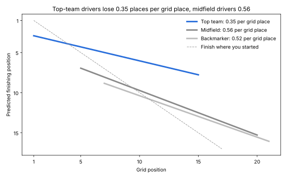

# Predicting race outcomes in Formula 1, 2014–2021

How much does qualifying position decide where a Formula 1 driver finishes, and does that depend on the team or the type of circuit? This is a multiple linear regression on 2,685 classified finishes from 160 Grands Prix.

## Findings

- Grid position and team tier explain 62% of the variance in finishing position (R² = 0.624). On races the model has not seen, the average error is 2.40 places, against 2.57 using grid position alone.
- The value of grid position depends on the car. Each grid place costs a top-team driver 0.35 finishing places, against 0.56 for midfield and 0.52 for backmarker drivers (grid × tier, χ²(2) = 40.4, p < 0.001).
- Circuit type does not change the value of grid position (grid × street, p = 0.305). The small street-circuit advantage comes from retirements: more cars retire on street circuits, so the finishers behind them move up. Once retirements ahead are counted, the street effect falls to −0.05 (p = 0.302).



## What changed from the first version

The first version fitted a main-effects model with team tier scored 1, 2 and 3. This version:

- enters team tier as categories, since equal spacing between tiers is rejected (p < 0.001)
- tests whether the grid effect differs by tier and by circuit type with interaction terms
- checks whether the street-circuit effect comes from retirements
- clusters standard errors by race
- tests prediction out of sample, with five-fold cross-validation by race and a 2014–2019 train, 2020–2021 test split
- re-derives team tiers from the previous season's constructors' championship as a robustness check

## Data

Race results and constructors' standings come from the Ergast dataset, served by the [Jolpica API](https://api.jolpi.ca/ergast/f1/). The notebook downloads them on its first run (about 50 requests) and caches them in `data/`.

## Run it

```
pip install -r requirements.txt
jupyter notebook f1_race_outcomes_revised.ipynb
```

Tested with Python 3.13.16.
